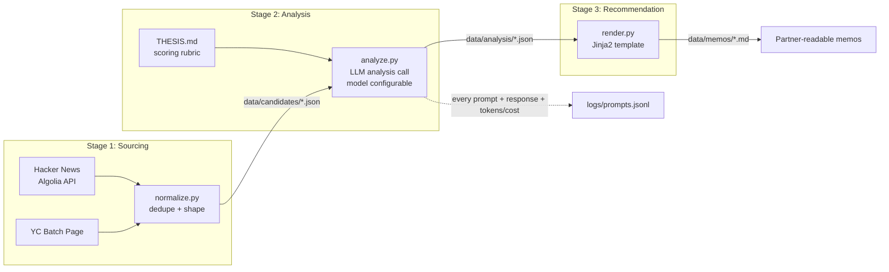

# AI-Augmented Investment Pipeline

Sources candidate startups, analyzes them against a stated investment thesis,
and writes a one-page Pass/Watch/Meet memo per startup — without a human
reading Product Hunt/HN/YC/Twitter/Crunchbase by hand first.

## How it works

Three independent stages, connected only by flat JSON files on disk — no
queue, no database, no server. Each stage is replayable on its own: re-render
memos without re-scraping, or re-run analysis without re-paying for sourcing.



See [Architecture](docs/architecture.md) for the full data-flow table and
design rationale.

## Project structure

```
.
├── cli.py entrypoint: python cli.py --topic "AI agents for SMBs"
├── config.py shared slugify() cache-key + LLM_API_KEY helper
├── requirements.txt
│
├── sourcing/ Stage 1: Sourcing
│ ├── hn_source.py Hacker News Algolia API
│ ├── yc_source.py YC W25 hardcoded list (page is JS-rendered)
│ └── normalize.py dedupe + shared Candidate shape
│
├── analysis/ Stage 2: Analysis
│ ├── schema.py Analysis Pydantic model (Team/Product/Market/Risks/Score)
│ └── analyze.py LLM call, cache check, prompt logging
│
├── memo/ Stage 3: Recommendation
│ ├── template.md fixed memo section order
│ └── render.py fills template from Candidate + Analysis
│
├── data/ committed pipeline outputs (read without any API key)
│ ├── candidates/ raw sourced startups (*.json)
│ ├── analysis/ structured analysis per startup (*.json)
│ └── memos/ final one-page memos (*.md)
│
├── logs/
│ └── prompts.jsonl every LLM call: prompt, response, model, tokens, cost
│
├── tests/ one test file per module above, TDD-first
│
└── docs/ everything needed to understand or rebuild this project
 ├── architecture.md HLD, data flow, design rationale
 ├── THESIS.md the investment thesis + scoring rubric
 ├── PROCESS.md decision log: what was decided, why, AI vs. author
 └── specs/
 ├── *-design.md approved design spec (source of truth for "what")
 └── *-plan.md task-by-task implementation plan (source of truth for "how")
```

Sharing this project so someone can rebuild it independently? `README.md` +
`requirements.txt` + all of `docs/` is the complete, code-free spec — no need
to also send the implementation to convey the design.

## Quick start

```bash
pip install -r requirements.txt

# Option A: export API key (OpenAI, OpenRouter, etc.)
export LLM_API_KEY=sk-...
export LLM_API_BASE=https://openrouter.ai/api/v1   # optional, defaults to OpenAI
export LLM_MODEL=openai/gpt-4o-mini                # optional, defaults to gpt-4o-mini

# Option B: create a .env file (LLM_API_KEY, LLM_API_BASE, LLM_MODEL)
# (.env is gitignored — key stays local)

python cli.py --topic "AI agents for SMBs" --limit 15
```

All pipeline outputs are already committed under `data/`, so you can read
results without setting `LLM_API_KEY` at all. It's only needed to analyze
startups not already in the committed dataset — see
[Architecture](docs/architecture.md#running-without-an-llm-api-key).

Outputs (all committed to this repo so they can be read without re-running):

- `data/candidates/` — raw sourced startups
- `data/analysis/` — structured Team/Product/Market/Risk/Score per startup
- `data/memos/` — final one-page memos
- `logs/prompts.jsonl` — every LLM call made, with tokens/cost, for traceability

## Docs

- [Architecture](docs/architecture.md) — pipeline design, data flow, why it's shaped this way
- [Investment Thesis](docs/THESIS.md) — the specific thesis and scoring rubric this pipeline scores against
- `docs/specs/` — design spec (the "what") and implementation plan (the "how"), written before any code
- [Process](docs/PROCESS.md) — decision log: what was decided, why, what AI drafted vs. reviewed; updated as the build progresses
- [OpenRouter](https://openrouter.ai/labs) — LLM provider used for analysis (OpenAI-compatible, configure via `.env`)

## Status

Implementation complete. All 9 tasks in `docs/specs/investment-pipeline-plan.md`
are done. The repo includes 29 committed candidate analyses and memos
from a real pipeline run (HN Algolia + hardcoded YC W25 → LLM analysis →
markdown memos).
