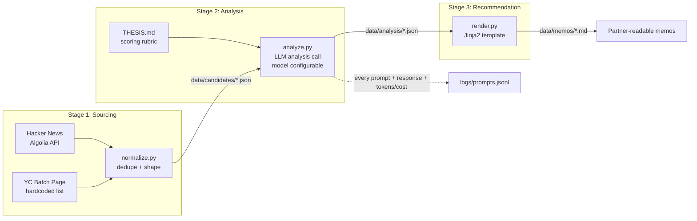

# Architecture

## In three steps

1. **Source** — pull 10-20 candidate startups from Hacker News + YC's batch page.
2. **Analyze** — score each one against a stated investment thesis, using an LLM.
3. **Recommend** — render a one-page Pass/Watch/Meet memo per startup.

## High-level design

Three independent stages, connected only by flat JSON files on disk. No queue, no
database, no server — each stage is a script that reads one directory and writes
another. This keeps every stage replayable in isolation: re-render memos without
re-scraping, or re-run analysis without re-paying for sourcing.

## Data flow

| Stage          | Input                              | Output                   | Committed? |
|----------------|------------------------------------|--------------------------|------------|
| Sourcing       | topic/query, HN + YC               | `data/candidates/*.json` | Yes        |
| Analysis       | candidates JSON + `docs/THESIS.md` | `data/analysis/*.json`   | Yes        |
| Recommendation | analysis JSON + `memo/template.md` | `data/memos/*.md`        | Yes        |

Every LLM call made during Analysis is logged to `logs/prompts.jsonl` (prompt,
response, model, token counts, estimated cost) — this is what makes memo claims
traceable back to a source, and gives visibility into token/cost usage across a run.

## Why this shape (and what we chose not to build)

- **Files over a database/queue** — the whole pipeline runs on ≤20 candidates,
  once per invocation. A DB or job queue would be pure overengineering for this
  scope (the take-home explicitly flags this as a red flag).
- **Structured (Pydantic) output over free-text LLM responses** — costs a bit more
  prompt-engineering effort upfront, but makes the memo renderer and scoring
  reliable and testable instead of parsing prose.
- **Caching by file existence** — if `data/analysis/<slug>.json` already exists,
  Analysis skips the API call. Keeps re-runs cheap and idempotent.

## Directory layout

See the "Project structure" section in the [root README](../README.md#project-structure)
for the full, annotated file tree — kept in one place there so it doesn't
drift out of sync with a second copy here.

See [`THESIS.md`](THESIS.md) for the investment thesis and scoring rubric this
pipeline is built around.

## Running without an LLM API key

Reading the outputs never requires a key — `data/candidates/`, `data/analysis/`,
and `data/memos/` are committed. A key (`LLM_API_KEY`, set to whichever
provider's key `analysis/analyze.py` is configured for) is only needed to
analyze a candidate that isn't already cached:

- **Sourcing** never needs a key — HN uses plain HTTP calls, YC uses a
  hardcoded company list (the batch page is JS-rendered, not scraper-friendly).
- **Analysis** checks `data/analysis/<slug>.json` first; on a cache hit it
  skips the API call entirely. Re-running the pipeline against the startups
  already in this repo works with no key set.
- On a cache miss with no key set, the pipeline fails with a clear message
  ("no LLM_API_KEY set and no cached analysis for `<name>`") instead of a
  stack trace — it does not fall back to a second provider or a mock model.
  Supporting multiple LLM providers was deliberately out of scope here.

Configuration is via environment variables (or `.env` file):
- `LLM_API_KEY` — your API key (OpenAI, OpenRouter, etc.)
- `LLM_API_BASE` — API base URL (defaults to `https://api.openai.com/v1`)
- `LLM_MODEL` — model name (defaults to `gpt-4o-mini`)